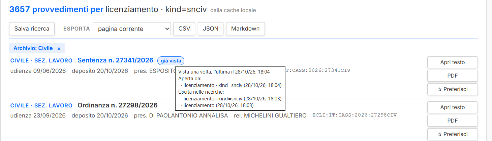
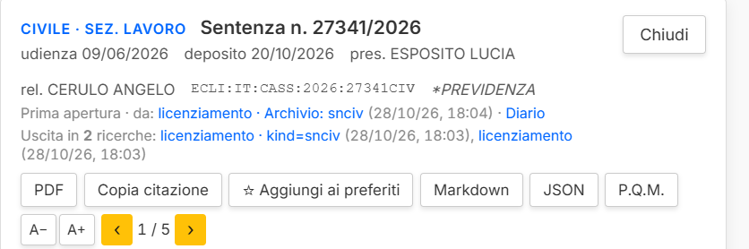
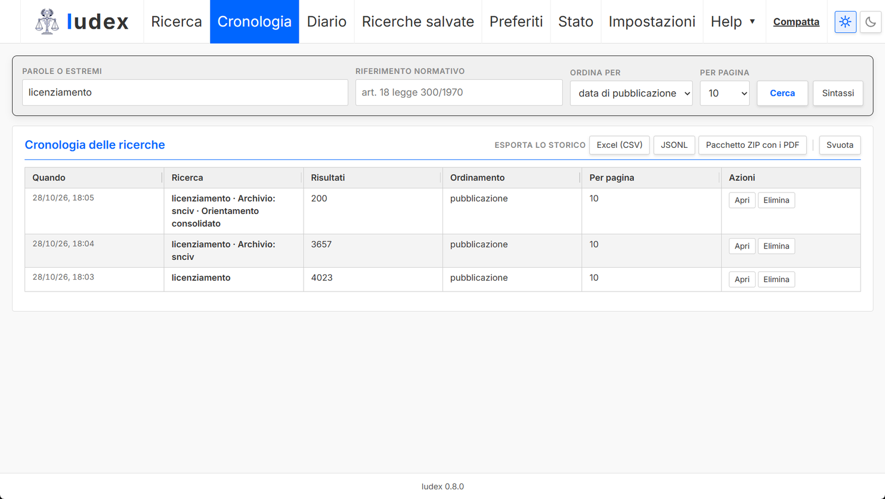
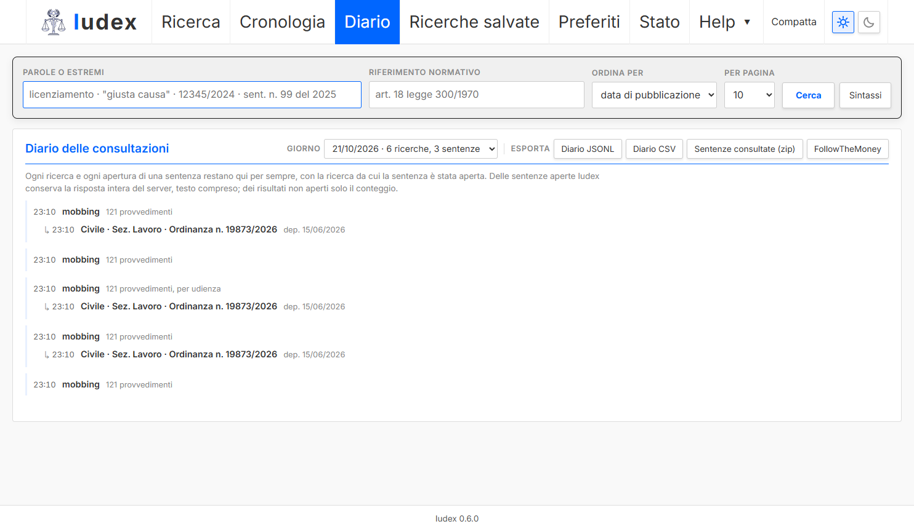
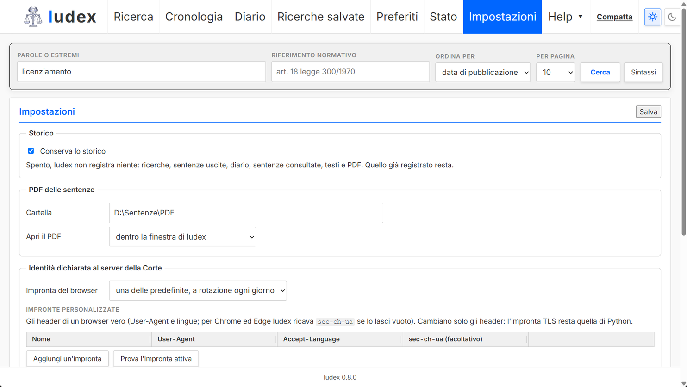

<p align="center">
  <picture>
    <source media="(prefers-color-scheme: dark)" srcset="docs/immagini/logo-scuro.png">
    
  </picture>
</p>

# Iudex

[](https://github.com/SOsintOps/Iudex/actions/workflows/ci.yml)

Interfaccia locale per interrogare **SentenzeWeb**, la banca dati pubblica delle sentenze
civili e penali della Corte Suprema di Cassazione (<https://www.italgiure.giustizia.it/sncass/>).

Iudex non è un archivio e non copia la banca dati: ogni ricerca interroga il server della
Corte come farebbe il browser, ma in una finestra propria, con un'interfaccia pensata per
leggere e confrontare e con una memoria permanente di ciò che hai cercato e consultato:
ricerche, sentenze uscite da ciascuna, testi e PDF aperti, esportabili e importabili su un
altro computer.


## Che cosa fa

- **Ricerca** per parole, frase esatta, troncamento, operatori `AND`/`OR`/`NOT`, estremi
  (`12345/2024`, `sent. n. 99 del 2025`) e **riferimento normativo** (`art. 18 legge 300/1970`),
  con la stessa sintassi e gli stessi risultati del sito ufficiale (e `NOT`, che sul sito non
  esclude, qui esclude davvero).
- **Filtri** per archivio (civile/penale), tipo di provvedimento, sezione, anno,
  sottosezione e **materia**, con i conteggi, in selezione multipla.
- **Testo integrale** in un pannello di lettura accanto ai risultati, ricostruito in
  paragrafi, con le occorrenze evidenziate e navigabili (`n`/`p`), il salto al P.Q.M., il
  dispositivo, i **riferimenti normativi** indicizzati dal CED (cliccabili: cercano le sentenze
  che citano la stessa norma) e il **PDF ufficiale**, salvato in locale alla prima apertura e
  mostrato nella finestra o con il programma PDF del computer.
- **Testo delle norme**: accanto ai riferimenti normativi della sentenza il bottone **Testo**
  apre l'articolo letto da **Normattiva** (fonte ufficiale, dati IPZS in licenza CC BY 4.0),
  con la vigenza e il link al sito; regolamenti e direttive UE, il TUE e il TFUE hanno il link
  **EUR-Lex**. Vedi [Normattiva](#normattiva).
- **Memoria permanente**: ogni ricerca e ogni pagina di risultati vista, con le sentenze
  mostrate, la macchina e l'ora; un badge **"già vista"** nei risultati dice, al passaggio del
  mouse, quando hai consultato la sentenza e da quali ricerche è uscita. Si può spegnere
  nelle Impostazioni.
- **Cronologia**, **ricerche salvate** con **controllo delle novità** su richiesta,
  **preferiti con note**; ogni ricerca ha un collegamento diretto (permalink)
  (`#testo=…&kind=snciv&anno=2026`).
- **Diario**: archivio personale permanente, per giorno, delle ricerche e delle sentenze
  aperte da ciascuna (testo e PDF); delle sentenze aperte conserva la risposta intera del
  server, testo compreso, e le riapre anche senza rete.
- **Esportazione dello storico** in CSV per Excel, JSONL o un pacchetto ZIP con i PDF, e
  **importazione** in un altro Iudex (unione senza duplicati, anche da una copia del
  database); copia di sicurezza automatica prima delle migrazioni e delle importazioni.
- **Impostazioni**: conservazione dello storico, cartella e apertura dei PDF, impronta del
  browser dichiarata alla Corte (a rotazione, fissa, personalizzata o personalizzate a
  rotazione), nome del computer.
- **Esportazione** della pagina di risultati o dei primi 50/100 risultati in CSV, JSON o
  Markdown, e della singola sentenza in Markdown o JSON, con la citazione pronta da copiare.
- **Colonne ridimensionabili** trascinando le maniglie (pannelli e tabelle), tema chiaro e
  scuro, righe compatte, carattere regolabile, scorciatoie da tastiera, nessuna dipendenza
  esterna nella pagina.
- Menu **Help** con la **guida all'utilizzo**, le **domande frequenti**, le **versioni**, i
  **software simili** e la **licenza**.
- Grafica allineata a [Exploratores](https://github.com/SOsintOps/Exploratores) (stessi
  colori, font Inter in locale, stessa barra di navigazione), più un **tema scuro** che si
  attiva da solo in base all'orario (dalle 19 alle 7, orari modificabili).

## Schermate

Il badge **già vista** segna le sentenze già consultate; al passaggio del mouse dice quando,
da quale ricerca sono state aperte e in quali ricerche sono uscite.



Nel pannello di lettura, sopra il testo, quante volte hai aperto la sentenza, da quali
ricerche e in quante ricerche è uscita fra i risultati.



Vista compatta con il tema scuro, che si attiva da solo la sera: solo estremi, date,
presidente, relatore ed ECLI; a sinistra i segnali di orientamento (qui il filtro
«Orientamento consolidato» attivo) e i filtri con le barre proporzionali.


La Cronologia conserva ogni ricerca per sempre ed esporta lo storico in CSV per Excel, JSONL o
un pacchetto ZIP con i PDF, che si importa in un altro Iudex.



Il Diario conserva, giorno per giorno, le ricerche e le sentenze aperte da ciascuna, con il
testo; da qui si esporta in JSONL, CSV, zip o FollowTheMoney.



Le Impostazioni decidono se conservare lo storico, dove salvare e aprire i PDF, quale impronta
del browser dichiarare alla Corte, gli orari del tema scuro e il nome del computer.



Le pagine informative integrate (domande frequenti, versioni, software simili) usano lo
stesso stile e sono raggiungibili dal menu Help della barra di navigazione.


Le schermate mostrano ricerche reali, fatte dalla finestra di Iudex 0.8 con un archivio di
prova; per rispetto delle persone citate nei provvedimenti sono state scelte viste senza nomi
delle parti.

## Come interroga il sito (e perché è più leggero del sito stesso)

Il sito ufficiale, per una sola ricerca, invia al server circa venti richieste: una per
ogni lettera digitata (suggerimenti), la ricerca, quattro chiamate per i conteggi dei
filtri e una di telemetria. Iudex ne invia **una**, perché chiede i conteggi dei filtri
nella stessa richiesta della ricerca. Inoltre:

| Regola | Valore |
|--------|--------|
| Richieste in parallelo | 1 |
| Intervallo minimo fra due richieste | 2 secondi (`IUDEX_INTERVALLO`) |
| Nuovi tentativi | 1 solo, su errore di rete o 5xx; nessuno su 403/429 |
| Suggerimenti mentre si digita | nessuna richiesta al server: la lista delle sigle normative è scaricata una volta e tenuta 30 giorni |
| Risposte di ricerca | in cache locale per un'ora: ripetere o ricaricare una ricerca non chiama il server |
| Testi aperti | conservati in locale: riaprire una sentenza non chiama il server |
| Controllo novità delle ricerche salvate | solo su clic, una richiesta per ricerca |
| Esportazioni | pagina corrente: nessuna richiesta; primi 50: al più una; primi 100: al più due |
| PDF | una richiesta alla prima apertura di una sentenza (con lo stesso ritmo delle altre), poi dalla copia locale; mai in blocco |
| Telemetria del sito (`xway`) | non replicata (`IUDEX_TELEMETRIA=1` per replicarla) |
| Identità dichiarata | User-Agent e header di un browser: per impostazione predefinita Chrome, Edge o Firefox su Windows scelto dal giorno; nelle Impostazioni una predefinita fissa, una personalizzata (controllata perché sia coerente) o le personalizzate a rotazione; `IUDEX_IMPRONTA` le fissa tutte. Cambiano solo gli header: l'impronta TLS resta quella di Python |
| Accesso locale | pagine, API e PDF rispondono solo alla finestra di Iudex (token nella cartella dei dati); un browser o un altro sito non possono usarli |

Non c'è alcuna funzione di scaricamento massivo o di scansione dell'archivio, e non va
aggiunta: la banca dati è della Corte, che la pubblica per la consultazione.

I dettagli degli endpoint, dei parametri e dei campi sono in
[docs/analisi-sito.md](docs/analisi-sito.md); la guida all'uso in [docs/guida.md](docs/guida.md);
le risposte alle domande più comuni in [docs/faq.md](docs/faq.md); i progetti affini in
[docs/software-simili.md](docs/software-simili.md).

## Normattiva

Dalla 0.9 Iudex legge anche il testo delle norme citate nelle sentenze, da **Normattiva**,
il portale ufficiale della normativa italiana. La fonte è l'**API Open Data** di Normattiva
(`api.normattiva.it`), non il sito `www.normattiva.it`, che resta un link da aprire nel
browser.

- **Bottone Testo**: accanto a un riferimento normativo della sentenza apre, sotto i
  riferimenti, l'articolo con titolo dell'atto, numero e rubrica, testo a commi, note
  richiudibili, vigenza e il link **Apri su Normattiva**. Compare solo quando il riferimento
  ha tutti i dati certi: per i codici (c.c., c.p., c.p.c., c.p.p., Costituzione) basta
  l'articolo, per leggi e decreti servono anche numero e anno. Leggi regionali e CEDU non
  hanno il bottone.
- **Strumento MCP `leggi_norma`**: lo stesso testo per un assistente, da un riferimento
  scritto come in una citazione (`"art. 2043 c.c."`) o dai campi espliciti, con la data di
  vigenza facoltativa (vedi [la sezione MCP](#con-un-assistente-o-un-llm-locale-mcp)).
- **API locale** `GET /api/norma?tipo=&numero=&anno=&articolo=&vigenza=`, usata da entrambi.
- **EUR-Lex**: regolamenti e direttive UE, il TUE e il TFUE hanno al posto del bottone un link
  che apre l'atto in italiano su EUR-Lex nel browser (numero CELEX); Iudex non chiede nulla a
  EUR-Lex.

**Fonte e licenza.** I testi sono dati dell'Istituto Poligrafico e Zecca dello Stato (IPZS),
pubblicati da Normattiva in licenza **CC BY 4.0**. Iudex li mostra con l'attribuzione
"Fonte: Normattiva (IPZS), CC BY 4.0" e il link all'atto; chi riusa un testo letto con Iudex
deve riportare la stessa attribuzione.

| Regola | Valore |
|--------|--------|
| Richieste | una per clic su **Testo** (o per chiamata di `leggi_norma`), mai all'apertura di una sentenza, nessuna lettura anticipata; al primo uso di un atto due (ricerca dell'atto e articolo), poi una |
| Intervallo minimo fra due richieste | 2 secondi (`IUDEX_INTERVALLO_NORMATTIVA`), con un limite proprio, separato da quello della Corte |
| Nuovi tentativi | 1 solo quando la fonte non risponde; pausa quando Normattiva la chiede (409/429); dopo un errore il pannello non ritenta da solo |
| Cache | il testo vigente resta in locale 30 giorni, quello chiesto a una data precisa resta; riaprire un articolo non chiede nulla |
| Fonte non raggiungibile | il messaggio dice che Normattiva non è disponibile, mai che la norma non esiste |

**Limiti.** Iudex legge un articolo alla volta: allegati e tabelle degli atti non sono
mostrati (per quelli c'è **Apri su Normattiva**). Normattiva non ha leggi regionali,
regolamenti UE e CEDU: per quelli `/api/norma` risponde 422. Il testo entra nella pagina solo
come testo, mai come HTML.

## Installazione

### Con l'installer (consigliato)

Dalla pagina delle [release](https://github.com/SOsintOps/Iudex/releases/latest):

- **Windows**: `Iudex-X.Y.Z-setup.exe`. Si installa per l'utente, senza diritti di
  amministratore, in `%LOCALAPPDATA%\Programs\Iudex`, e chiede in quale cartella conservare i
  PDF; apre Iudex in una finestra propria (componente WebView2, già presente in Windows 11;
  su Windows 10 l'installer avvisa se manca) con un'icona nell'area di notifica. I dati
  stanno in `%APPDATA%\Iudex` e restano anche dopo la disinstallazione. L'installer non è
  firmato con un certificato di firma del codice: Windows SmartScreen può chiedere conferma
  ("Ulteriori informazioni", "Esegui comunque"); lo sha256 di ogni file è in `latest.json`
  nella release.
- **Linux**: `Iudex-X.Y.Z-x86_64.AppImage` (renderlo eseguibile con `chmod +x`): apre la
  finestra con WebKitGTK del sistema (`sudo apt install gir1.2-webkit2-4.1 python3-gi` su
  Debian e Ubuntu; se manca, Iudex lo dice) e al primo avvio chiede la cartella dei PDF;
  dati in `~/.local/share/iudex`.

### Dai sorgenti

Serve Python 3.11 o successivo.

```bat
git clone https://github.com/SOsintOps/Iudex.git
cd Iudex
python -m venv .venv
.venv\Scripts\python.exe -m pip install -e .[desktop]
scripts\avvia-finestra.cmd
```

`scripts\avvia-finestra.cmd` (o `python -m iudex.desktop`) apre la finestra di Iudex; se
Iudex è già acceso apre quello invece di avviarne un secondo. Su Linux:
`.venv/bin/python -m iudex.desktop`, con WebKitGTK e PyGObject del sistema (Debian e Ubuntu:
`sudo apt install gir1.2-webkit2-4.1 python3-gi`, e il venv creato con
`--system-site-packages`). Dai sorgenti i dati (cronologia, diario, esecuzioni, preferiti,
impostazioni, cache, token) stanno in `dati/iudex.sqlite` e nella cartella `dati/`, i PDF in
`dati/pdf/` salvo scelta diversa; le voci di cache scadute vengono tolte a ogni avvio.

`python -m iudex` avvia il solo server, senza finestra, per chi integra Iudex in un'altra app
(argomenti `--data-dir`, `--port`, `--parent-pid`): pagine e API chiedono il token del file
`token` nella cartella dei dati, nell'header `X-Iudex-Token`.

Ogni settimana, all'avvio, e prima di ogni migrazione dello schema e di ogni importazione,
Iudex fa una copia di sicurezza del database in `backup/` nella cartella dei dati
(`VACUUM INTO`, le ultime otto). I PDF non sono nel database: per conservarli altrove usa il
pacchetto ZIP dalla scheda Cronologia. L'app installata controlla all'avvio se
c'è una versione nuova (una richiesta a GitHub per `latest.json` della release più recente,
senza altri dati) e lo segnala nella scheda Stato; l'installer si scarica e si avvia solo
premendo "Scarica e installa", dopo il controllo dello sha256. `IUDEX_AGGIORNAMENTI=0` spegne
il controllo.

Variabili d'ambiente: `IUDEX_PORTA` (8765), `IUDEX_HOST` (127.0.0.1), `IUDEX_DATI`
(cartella dei dati), `IUDEX_INTERVALLO` (secondi fra le richieste alla Corte),
`IUDEX_INTERVALLO_NORMATTIVA` (secondi fra le richieste a Normattiva), `IUDEX_TTL_RICERCHE`
(secondi di validità della cache delle ricerche), `IUDEX_TELEMETRIA`, `IUDEX_AGGIORNAMENTI` (`0`
spegne il controllo degli aggiornamenti, `1` lo accende anche dai sorgenti), `IUDEX_IMPRONTA`
(`chrome`, `edge` o `firefox` per dichiarare sempre lo stesso browser, qualunque cosa dicano
le Impostazioni; la scheda Stato mostra quale), `IUDEX_TOKEN` (per il server MCP, al posto del
file `token`). Iudex è pensato per `127.0.0.1`: le API accettano solo richieste con un `Host`
locale, quindi un indirizzo diverso (per esempio `0.0.0.0` per la rete locale) va aggiunto
anche come `IUDEX_HOST`; il token protegge l'accesso, ma la connessione resta in HTTP.

### Finestra nativa

```bat
.venv\Scripts\python.exe -m pip install -e .[desktop]
scripts\avvia-finestra.cmd
```

È l'unico modo di usare Iudex, come in Voicebox: una finestra propria (componente WebView2
di Windows; WebKitGTK su Linux, WebKit su macOS), con un'icona nell'area di notifica (Apri,
Mantieni in esecuzione, Esci), che ferma il server quando la chiudi. La finestra entra con
il token della cartella dei dati (`/accesso?codice=...`, poi un cookie di sessione); un
browser che apre l'indirizzo locale vede solo l'invito ad aprire Iudex dalla finestra. Se
Iudex è già acceso su quella porta, la finestra apre quello invece di avviarne un secondo; se
la porta è occupata da un altro programma, usa la successiva libera. `--data-dir` e `--port`
scelgono cartella dei dati e porta.

Come backend di un'altra app, `python -m iudex --data-dir CARTELLA --port PORTA --parent-pid
PID` avvia solo il server e lo chiude quando termina il processo `PID`; `GET /health`
risponde `{"app": "iudex", "versione", "pid"}` senza token, così chi lo avvia riconosce la
propria istanza; le altre chiamate vogliono l'header `X-Iudex-Token` con il contenuto del file
`token`. Il log va in `log/iudex.log` nella cartella dei dati, con rotazione.

### Con un assistente o un LLM locale (MCP)

```bat
.venv\Scripts\python.exe -m pip install -e .[mcp]
```

Con Iudex aperto, `python -m iudex.mcp_server` espone cinque strumenti MCP, tutti in sola
lettura, che passano dall'API locale, quindi dalla cache e dalla limitazione della frequenza
delle richieste:

| Strumento | Che cosa fa |
|-----------|-------------|
| `cerca_sentenze` | cerca sentenze della Cassazione per parole, frase, troncamento o estremi, con i filtri per archivio, anno, sezione, tipo e segnale |
| `cerca_per_norma` | cerca le sentenze che citano un riferimento normativo (`"art. 18 legge 300/1970"`) |
| `leggi_sentenza` | estremi, dispositivo, riferimenti normativi e testo integrale di una sentenza |
| `leggi_norma` | testo di un articolo da Normattiva, con vigenza, link e fonte |
| `verifica_citazioni` | controlla fino a 10 citazioni di sentenze della Cassazione per chiamata |

Il server MCP legge il token dal file `token` della cartella dei dati (la stessa di Iudex:
`IUDEX_DATI` se l'hai cambiata) oppure da `IUDEX_TOKEN`. Esempio per LM Studio (`mcp.json`)
o Claude Desktop:

```json
{
  "mcpServers": {
    "iudex": {
      "command": "C:\\percorso\\di\\Iudex\\.venv\\Scripts\\python.exe",
      "args": ["-m", "iudex.mcp_server"]
    }
  }
}
```

Serve un modello che sappia chiamare strumenti; gli strumenti sono pochi, quindi anche un
modello piccolo li gestisce. Le istruzioni del server chiedono all'assistente di non
ripetere ricerche identiche e di non scorrere molte pagine. `cerca_sentenze` accetta il
filtro `segnale` (contrasto o conformità) e riporta i conteggi dei segnali; `leggi_sentenza`
alla prima lettura di un testo lungo restituisce l'inizio e la parte dal P.Q.M., indicando
i caratteri omessi. Gli errori (Iudex spento, pausa chiesta dal server) arrivano al modello
come errori dello strumento, con il messaggio leggibile. Richiede `mcp` 2.x.

`leggi_norma` restituisce il testo di un articolo da Normattiva (fonte ufficiale, dati IPZS in
licenza CC BY 4.0) con le date di vigenza e il link: accetta un riferimento scritto come in
una citazione (`"art. 2043 c.c."`, `"art. 13 d.lgs. 196/2003"`, `"art. 2-bis l. 241/1990"`)
oppure i campi `tipo`, `numero`, `anno`, `articolo` e la data di `vigenza` facoltativa, e
passa da `GET /api/norma`: al più una richiesta a Normattiva, nessuna se l'articolo è già
nella cache.

`verifica_citazioni` controlla fino a 10 citazioni di sentenze della Cassazione per chiamata,
anche nella forma con le virgole e la data:

```json
{"citazioni": ["Cass. civ., Sez. Un., 11 novembre 2008, n. 26972",
               "Cass. pen. sez. VI n. 1234/2020", "Cass. civ. n. 1234/2031"]}
```

Per ciascuna guarda prima le sentenze già consultate su questo computer e solo se manca fa
una richiesta alla Corte (con `/api/cerca`, quindi con il ritmo di 2 secondi e le pause di
Iudex), una per citazione e in sequenza. Gli esiti: **esiste** (con id ed ECLI, e un avviso
se la sezione citata non coincide), **non trovata** (gli estremi non sono nell'archivio
online di SentenzeWeb: non prova che la sentenza non esista), **fonte non raggiungibile**
(la Corte non ha risposto o ha chiesto una pausa: verifica non fatta, e per le citazioni
successive della stessa chiamata non si insiste), **fuori archivio** (anno futuro o anteriore
al 2000, scartato senza richieste) e **non interpretabile**.

### Certificato TLS

Il server della Corte invia una catena di certificati incompleta (manca l'intermedio
"TI Trust Technologies OV CA"). I browser la completano da soli, Python no: Iudex include
l'intermedio in `src/iudex/certs/ti_trust_ov_ca.pem` e lo aggiunge al contesto TLS, senza
disattivare la verifica.

### Da dietro una VPN

Il server della Corte non risponde alle connessioni che arrivano dagli indirizzi di uscita
delle VPN commerciali: il collegamento alla porta 443 resta senza risposta, e Iudex segnala
«errore di rete». Non è un limite di Iudex, né un blocco delle richieste: lo stesso succede
aprendo il sito nel browser.

Il rimedio è lasciare fuori dal tunnel solo il traffico verso il sito della Corte, con
l'esclusione dal tunnel (*split tunneling*) per **indirizzo IP** (`www.italgiure.giustizia.it`,
oggi 81.126.56.168, rete Telecom Italia). Così tutto il resto resta nella VPN, mentre le
ricerche e i PDF ufficiali, che Iudex scarica dallo stesso sito, raggiungono la Corte in
modo diretto: la Corte vede quindi l'indirizzo reale per quelle richieste. Dalla 0.8 anche
escludere il solo eseguibile di Iudex basta, perché i PDF li scarica Iudex e non il browser.

## Sviluppo

Le regole per contribuire sono in [CONTRIBUTING.md](CONTRIBUTING.md), la segnalazione
delle vulnerabilità in [SECURITY.md](SECURITY.md), il codice di condotta in
[CODE_OF_CONDUCT.md](CODE_OF_CONDUCT.md).

```bat
.venv\Scripts\python.exe -m pip install -e .[dev]
.venv\Scripts\python.exe -m ruff check src tests packaging
.venv\Scripts\python.exe -m pytest
```

I test non toccano la rete (le risposte del server sono simulate).

Struttura:

| Modulo | Compito |
|--------|---------|
| `src/iudex/query.py` | costruzione delle query Solr secondo la sintassi del sito (implementazione propria); riferimenti normativi |
| `src/iudex/client.py` | client HTTP con la limitazione delle richieste e il contesto TLS |
| `src/iudex/norme.py` | testo delle norme dall'API Open Data di Normattiva (client, parser degli articoli), link EUR-Lex, norme citate per l'export FtM |
| `src/iudex/cache.py` | SQLite con schema versionato e migrazioni: cronologia, esecuzioni e risultati, ricerche salvate, preferiti, testi, cache, diario, sentenze consultate, PDF, impostazioni, macchine; unione di un altro archivio |
| `src/iudex/export.py` | CSV, JSON, Markdown, JSONL, zip (anche dello storico); ricostruzione dei paragrafi |
| `src/iudex/importazione.py` | lettura di un pacchetto ZIP, di un JSONL o di una copia del database di un altro Iudex |
| `src/iudex/pdf.py` | cartella, nome e apertura dei PDF salvati |
| `src/iudex/preferenze.py` | impostazioni della scheda Impostazioni: predefinite, convalida, variabili d'ambiente |
| `src/iudex/impronte.py` | impronte del browser predefinite e personalizzate |
| `src/iudex/accesso.py` | token di accesso della finestra e del server MCP |
| `src/iudex/app.py` | server FastAPI, API JSON, protezione delle pagine e delle API |
| `src/iudex/mcp_server.py` | server MCP (extra `mcp`) |
| `src/iudex/desktop.py` | finestra nativa (extra `desktop`) |
| `src/iudex/autonoma/` | app autonoma: cartelle dei dati per sistema, server con `/health`, porta e sorveglianza del processo genitore, finestra con icona nell'area di notifica |
| `src/iudex/static/` | interfaccia e pagine di aiuto (HTML, CSS, JavaScript senza dipendenze), font, icone |
| `tests/` | test automatici (senza rete) |
| `packaging/` | installer: PyInstaller, Inno Setup (Windows), AppImage (Linux), `latest.json` |
| `docs/` | analisi del sito, guida, domande frequenti, software simili, immagini |
| `assets/logo/` | logo originale e script che generano logo, marchio, favicon e anteprima social (`docs/immagini/anteprima-social.png`) |
| `scripts/` | avviatori per Windows |
| `.github/` | integrazione continua (ruff + pytest), Dependabot, modelli per segnalazioni e pull request |

## Licenza

MIT. I testi delle sentenze sono della Corte Suprema di Cassazione e restano soggetti
alle condizioni con cui la Corte li pubblica. I testi delle norme sono dati dell'Istituto
Poligrafico e Zecca dello Stato, pubblicati da Normattiva in licenza CC BY 4.0 (fonte:
Normattiva, IPZS).
