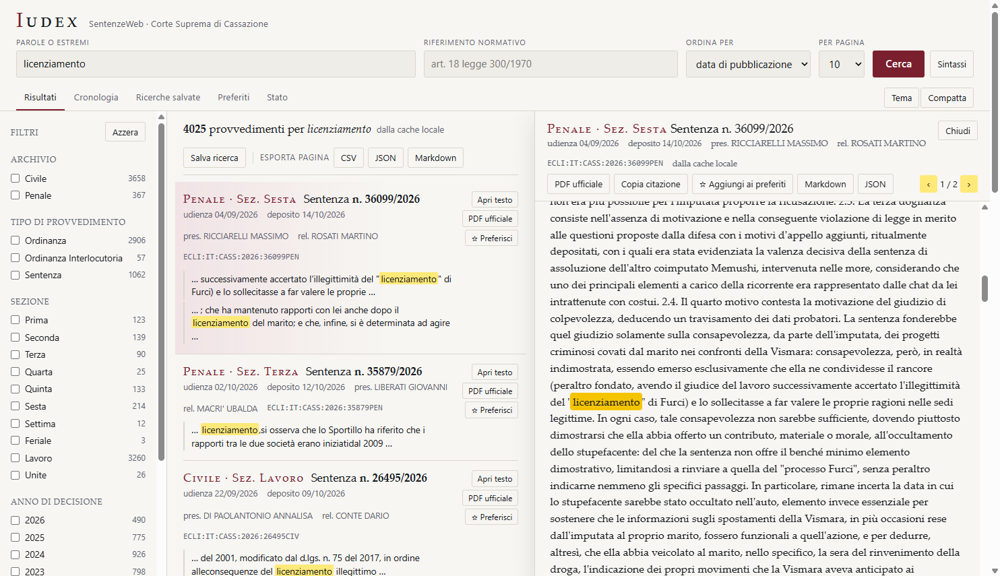
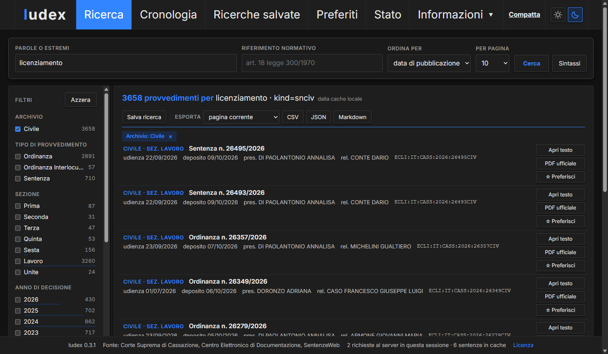
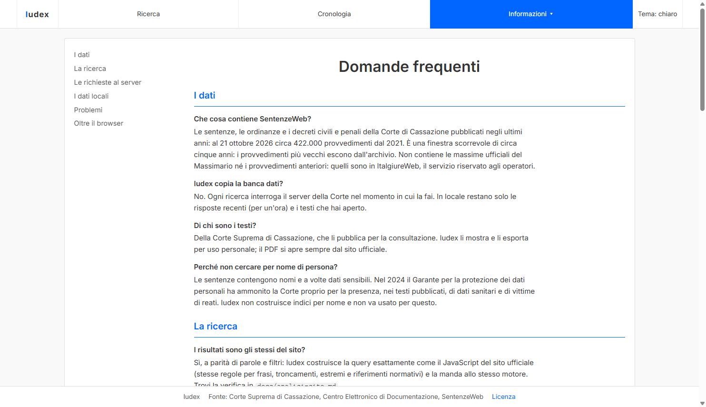

<p align="center">
  <picture>
    <source media="(prefers-color-scheme: dark)" srcset="docs/immagini/logo-scuro.png">
    
  </picture>
</p>

# Iudex

[](https://github.com/SOsintOps/Iudex/actions/workflows/ci.yml)

Interfaccia locale per interrogare **SentenzeWeb**, la banca dati pubblica delle sentenze
civili e penali della Corte Suprema di Cassazione (<https://www.italgiure.giustizia.it/sncass/>).

Iudex non è un archivio e non copia la banca dati: ogni ricerca interroga il server della
Corte come farebbe il browser, ma con un'interfaccia pensata per leggere e confrontare,
una cronologia, i preferiti, l'esportazione e una cache locale dei testi già aperti.



## Che cosa fa

- **Ricerca** per parole, frase esatta, troncamento, operatori `AND`/`OR`/`NOT`, estremi
  (`12345/2024`, `sent. n. 99 del 2025`) e **riferimento normativo** (`art. 18 legge 300/1970`),
  con la stessa sintassi e gli stessi risultati del sito ufficiale (e `NOT`, che sul sito non
  esclude, qui esclude davvero).
- **Filtri** per archivio (civile/penale), tipo di provvedimento, sezione, anno,
  sottosezione e **materia**, con i conteggi, in selezione multipla.
- **Testo integrale** in un pannello di lettura accanto ai risultati, ricostruito in
  paragrafi, con le occorrenze evidenziate e navigabili (`n`/`p`), il salto al P.Q.M., il
  dispositivo, i **riferimenti normativi** indicizzati dal CED (cliccabili: cercano le sentenze
  che citano la stessa norma) e il collegamento al **PDF ufficiale**.
- **Cronologia**, **ricerche salvate** con **controllo delle novità** su richiesta,
  **preferiti con note**; ogni ricerca ha un collegamento diretto (permalink)
  (`http://127.0.0.1:8765/#testo=…&kind=snciv&anno=2026`).
- **Diario**: archivio personale permanente, per giorno, delle ricerche e delle sentenze
  aperte da ciascuna; delle sentenze aperte conserva la risposta intera del server, testo
  compreso, e le riapre anche senza rete. Export in JSONL, CSV e zip; copia di sicurezza
  del database.
- **Esportazione** della pagina di risultati o dei primi 50/100 risultati in CSV, JSON o
  Markdown, e della singola sentenza in Markdown o JSON, con la citazione pronta da copiare.
- **Colonne ridimensionabili** trascinando le maniglie (pannelli e tabelle), tema chiaro e
  scuro, righe compatte, carattere regolabile, scorciatoie da tastiera, nessuna dipendenza
  esterna nel browser.
- Menu **Help** con la **guida all'utilizzo**, le **domande frequenti**, le **versioni**, i
  **software simili** e la **licenza**.
- Grafica allineata a [Exploratores](https://github.com/SOsintOps/Exploratores) (stessi
  colori, font Inter in locale, stessa barra di navigazione), più un **tema scuro** che si
  attiva da solo in base all'orario (dalle 19 alle 7, orari modificabili).

## Schermate

Vista compatta con il tema scuro, che si attiva da solo la sera: solo estremi, date,
presidente, relatore ed ECLI; i filtri a sinistra con le barre proporzionali.



Le pagine informative integrate (domande frequenti, versioni, software simili) usano lo
stesso stile e sono raggiungibili dal menu Help della barra di navigazione.



Le schermate mostrano ricerche reali; per rispetto delle persone citate nei provvedimenti
sono state scelte viste senza nomi delle parti.

## Come interroga il sito (e perché è più leggero del sito stesso)

Il sito ufficiale, per una sola ricerca, invia al server circa venti richieste: una per
ogni lettera digitata (suggerimenti), la ricerca, quattro chiamate per i conteggi dei
filtri e una di telemetria. Iudex ne invia **una**, perché chiede i conteggi dei filtri
nella stessa richiesta della ricerca. Inoltre:

| Regola | Valore |
|--------|--------|
| Richieste in parallelo | 1 |
| Intervallo minimo fra due richieste | 2 secondi (`IUDEX_INTERVALLO`) |
| Nuovi tentativi | 1 solo, su errore di rete o 5xx; nessuno su 403/429 |
| Suggerimenti mentre si digita | nessuna richiesta al server: la lista delle sigle normative è scaricata una volta e tenuta 30 giorni |
| Risposte di ricerca | in cache locale per un'ora: ripetere o ricaricare una ricerca non chiama il server |
| Testi aperti | conservati in locale: riaprire una sentenza non chiama il server |
| Controllo novità delle ricerche salvate | solo su clic, una richiesta per ricerca |
| Esportazioni | pagina corrente: nessuna richiesta; primi 50: al più una; primi 100: al più due |
| PDF | non scaricati da Iudex: il collegamento apre il documento sul sito della Corte |
| Telemetria del sito (`xway`) | non replicata (`IUDEX_TELEMETRIA=1` per replicarla) |
| Identità dichiarata | User-Agent e header di Chrome, come dal sito ufficiale |
| API locali | rispondono solo all'interfaccia di Iudex (header `X-Iudex: 1`): un altro sito aperto nel browser non può usarle |

Non c'è alcuna funzione di scaricamento massivo o di scansione dell'archivio, e non va
aggiunta: la banca dati è della Corte, che la pubblica per la consultazione.

I dettagli degli endpoint, dei parametri e dei campi sono in
[docs/analisi-sito.md](docs/analisi-sito.md); la guida all'uso in [docs/guida.md](docs/guida.md);
le risposte alle domande più comuni in [docs/faq.md](docs/faq.md); i progetti affini in
[docs/software-simili.md](docs/software-simili.md).

## Installazione

Serve Python 3.11 o successivo.

```bat
git clone https://github.com/SOsintOps/Iudex.git
cd Iudex
python -m venv .venv
.venv\Scripts\python.exe -m pip install -e .
scripts\avvia.cmd
```

`scripts\avvia.cmd` apre il browser su <http://127.0.0.1:8765/> e avvia il server; su Linux o
macOS: `.venv/bin/python -m iudex`. I dati locali (cronologia, diario, preferiti, cache) sono
archiviati in `dati/iudex.sqlite`.

Variabili d'ambiente: `IUDEX_PORTA` (8765), `IUDEX_HOST` (127.0.0.1), `IUDEX_DATI`
(cartella dei dati), `IUDEX_INTERVALLO` (secondi fra le richieste), `IUDEX_TTL_RICERCHE`
(secondi di validità della cache delle ricerche), `IUDEX_TELEMETRIA`.

### Finestra nativa

```bat
.venv\Scripts\python.exe -m pip install -e .[desktop]
scripts\avvia-finestra.cmd
```

Apre Iudex in una finestra propria (componente WebView2 di Windows 11; WebKitGTK su Linux,
WebKit su macOS) e ferma il server quando la chiudi. Un eseguibile autonomo con PyInstaller
è possibile ma non è fornito.

### Con un assistente o un LLM locale (MCP)

```bat
.venv\Scripts\python.exe -m pip install -e .[mcp]
```

Con Iudex in esecuzione, `python -m iudex.mcp_server` espone tre strumenti MCP
(`cerca_sentenze`, `cerca_per_norma`, `leggi_sentenza`) che passano dall'API locale, quindi
dalla cache e dalla limitazione della frequenza delle richieste. Esempio per LM Studio (`mcp.json`) o Claude Desktop:

```json
{
  "mcpServers": {
    "iudex": {
      "command": "C:\\percorso\\di\\Iudex\\.venv\\Scripts\\python.exe",
      "args": ["-m", "iudex.mcp_server"]
    }
  }
}
```

Serve un modello che sappia chiamare strumenti; gli strumenti sono tre, quindi anche un
modello piccolo li gestisce. Le istruzioni del server chiedono all'assistente di non
ripetere ricerche identiche e di non scorrere molte pagine.

### Certificato TLS

Il server della Corte invia una catena di certificati incompleta (manca l'intermedio
"TI Trust Technologies OV CA"). I browser la completano da soli, Python no: Iudex include
l'intermedio in `iudex/certs/ti_trust_ov_ca.pem` e lo aggiunge al contesto TLS, senza
disattivare la verifica.

## Sviluppo

Le regole per contribuire sono in [CONTRIBUTING.md](CONTRIBUTING.md), la segnalazione
delle vulnerabilità in [SECURITY.md](SECURITY.md).

```bat
.venv\Scripts\python.exe -m pip install -e .[dev]
.venv\Scripts\python.exe -m ruff check iudex tests
.venv\Scripts\python.exe -m pytest
```

I test non toccano la rete (le risposte del server sono simulate).

Struttura:

| Modulo | Compito |
|--------|---------|
| `iudex/query.py` | costruzione delle query Solr secondo la sintassi del sito (implementazione propria); riferimenti normativi |
| `iudex/client.py` | client HTTP con la limitazione delle richieste e il contesto TLS |
| `iudex/cache.py` | SQLite: cronologia, ricerche salvate, preferiti, testi, cache, diario e sentenze consultate |
| `iudex/export.py` | CSV, JSON, Markdown, JSONL, zip; ricostruzione dei paragrafi |
| `iudex/app.py` | server FastAPI, API JSON, protezione delle API |
| `iudex/mcp_server.py` | server MCP (extra `mcp`) |
| `iudex/desktop.py` | finestra nativa (extra `desktop`) |
| `iudex/static/` | interfaccia e pagine di aiuto (HTML, CSS, JavaScript senza dipendenze), font, icone |
| `tests/` | test automatici (senza rete) |
| `docs/` | analisi del sito, guida, domande frequenti, software simili, immagini |
| `assets/logo/` | logo originale e script che generano logo, marchio, favicon e anteprima social (`docs/immagini/anteprima-social.png`) |
| `scripts/` | avviatori per Windows |
| `.github/` | integrazione continua (ruff + pytest), Dependabot, modelli per segnalazioni e pull request |

## Licenza

MIT. I testi delle sentenze sono della Corte Suprema di Cassazione e restano soggetti
alle condizioni con cui la Corte li pubblica.
